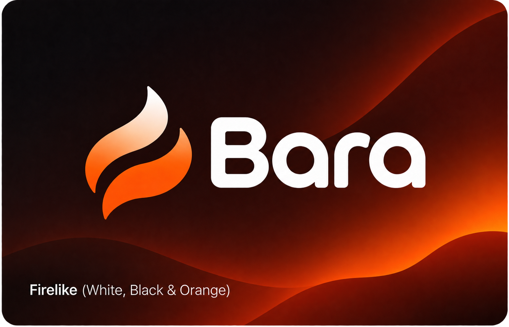
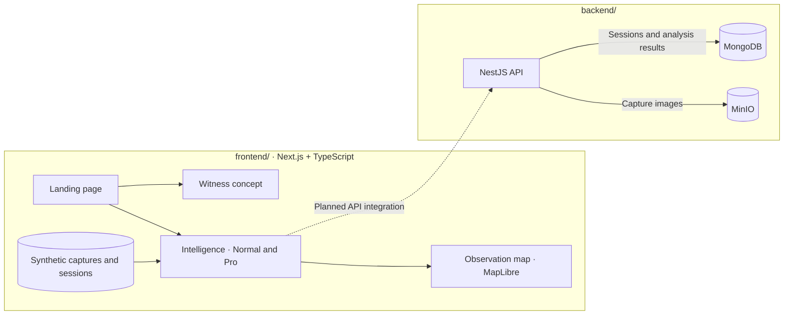

<div align="center">



# BARA

**Community reporting and incident intelligence for forest and land fires in Indonesia.**

See what people reported, where the evidence came from, and what remains unknown.

[](https://github.com/Toxinityy/bara-uiux/tree/main)
[](https://github.com/miroslavmatthew/BARAbackend/tree/main)


[Why BARA](#why-bara) · [Try the demo](#try-the-demo) · [Architecture](#architecture) · [Quickstart](#quickstart) · [Backend setup](#backend-setup) · [Repositories](#repositories)

</div>

---

## Why BARA

A witness sees smoke beyond a tree line. Their report can tell us where they were standing and what they saw. The source of the smoke may still be unknown. BARA keeps the original observation, its source, and the unanswered questions together so people reviewing reports can see what the evidence supports.

**Witness** is shown as a concept on the landing page. **Intelligence** lets reviewers explore capture sessions, trace evidence to individual observations, and look for patterns across space and time.

## Try the demo

After starting the app, open one of these routes:

| Surface | Route | What to try |
| --- | --- | --- |
| Landing page | [`/`](http://localhost:3000) | Explore the project and see the Witness concept. |
| Intelligence · Normal | [`/intelligence`](http://localhost:3000/intelligence) | Filter captures by session or time and expand individual photo findings. |
| Intelligence · Pro | [`/intelligence?mode=pro`](http://localhost:3000/intelligence?mode=pro) | On a tablet or desktop, inspect session checklists, follow evidence back to a capture, or compare two captures. |

Start with the **8-capture preview** to inspect sample photo findings and session checklists. Switch to the **72-capture map scenario** under **Data settings** to explore spatial patterns. Both datasets are synthetic and set in Central Kalimantan. Map points mark where observations were made.

## Architecture



## Quickstart

Use **Node.js 24**, npm, and Git. The demo runs with bundled data and needs no API keys or backend process.

```sh
git clone --recurse-submodules https://github.com/miroslavmatthew/BARA.git
cd BARA/frontend
npm ci
npm run dev
```

Open [localhost:3000](http://localhost:3000). If you already cloned BARA, run `git pull --ff-only` and then `git submodule update --init --recursive` from the parent repository before starting the frontend.

<details>
<summary>Frontend checks</summary>

Run these from `frontend/`:

```sh
npm test
npm run lint
npm run typecheck
npm run build
```

</details>

## Backend setup

Use Docker Compose to run the API and its storage services. From the BARA root, create the local configuration files on first setup:

```sh
cp backend/infrastructure/.env.example backend/infrastructure/.env
cp backend/bara-api/.env.example backend/bara-api/.env
```

Set the credentials in the infrastructure `.env`, then use the same MongoDB application credentials and MinIO credentials in the API `.env`. Set `OPENAI_API_KEY` in the API `.env` to enable model analysis.

```sh
(cd backend/infrastructure && docker compose up -d --build)
(cd backend/infrastructure && docker compose ps -a)
```

Once MongoDB and MinIO are healthy and `minio-init` has exited successfully, start the API and check that it can list sessions:

```sh
(cd backend/bara-api && docker compose up -d --build)
curl --fail http://localhost:3000/sessions
```

The API uses port `3000`. To run the frontend alongside it, start the frontend with `npm run dev -- --port 3001` from `frontend/` and open [localhost:3001](http://localhost:3001). Intelligence uses its bundled sample data in this checkout.

See the [backend setup guide](https://github.com/miroslavmatthew/BARAbackend/blob/main/README.md) for development commands and the [API contract](https://github.com/miroslavmatthew/BARAbackend/blob/main/UI-BACKEND-HANDOFF.md) for session and snapshot endpoints.

## Repositories

| Submodule | Role |
| --- | --- |
| [frontend/ on main](https://github.com/Toxinityy/bara-uiux/tree/main) | Landing page and Intelligence workspace |
| [backend/ on main](https://github.com/miroslavmatthew/BARAbackend/tree/main) | NestJS API, storage infrastructure, and integration docs |

The links above open each repository's live `main` branch. GitHub's folder entries open the commits recorded by BARA. To check out the latest `main` for both submodules locally, run this from the BARA root:

```sh
git submodule update --init --remote -- backend frontend
```

The frontend handoff describes how Intelligence maps its sample data to the backend contract. [Read the UI alignment notes](https://github.com/Toxinityy/bara-uiux/blob/main/docs/backend-ui-alignment.md).

---

<div align="center"><sub>Evidence in context. Uncertainty included.</sub></div>
