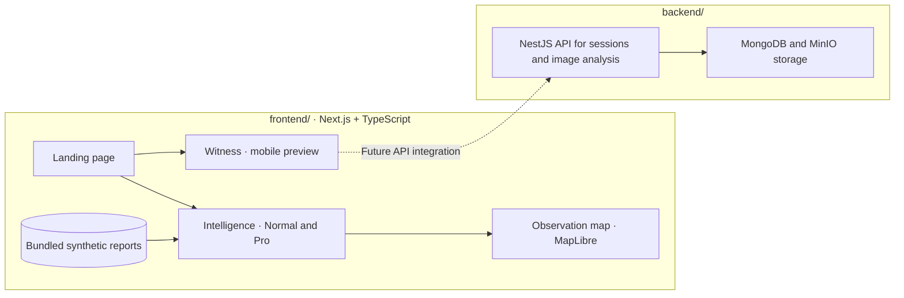

<div align="center">


# BARA

**Community reporting and incident intelligence for forest and land fires in Indonesia.**

See what people reported, where the evidence came from, and what remains unknown.

[](https://github.com/Toxinityy/bara-uiux/tree/witness-mobile)
[](https://github.com/miroslavmatthew/BARAbackend/tree/main)


[Why BARA](#why-bara) · [Try the demo](#try-the-demo) · [Architecture](#architecture) · [Quickstart](#quickstart) · [Repositories](#repositories)

</div>

---

## Why BARA

A witness sees smoke beyond a tree line. Their report can tell us where they were standing and what they saw. The source of the smoke may still be unknown. BARA keeps the original observation, its source, and the unanswered questions together so people reviewing reports can see what the evidence supports.

**Witness** previews how people can document an observation on a phone. **Intelligence** lets reviewers read reports in context, inspect provisional incident groups, and explore patterns across space and time.

## Try the demo

After starting the app, open one of these routes:

| Surface | Route | What to try |
| --- | --- | --- |
| Landing page | [`/`](http://localhost:3000) | Explore the project and open either demo. |
| Intelligence · Normal | [`/intelligence`](http://localhost:3000/intelligence) | Filter reports, open a provisional incident, and compare the report text with its map position. |
| Intelligence · Pro | [`/intelligence?mode=pro`](http://localhost:3000/intelligence?mode=pro) | Switch to the 72-report synthetic scenario, narrow the map by area or date, and inspect the evidence behind a pattern. |
| Witness | [`/witness`](http://localhost:3000/witness) | Open the mobile preview and try the camera, location, and compass controls where supported. |

> Intelligence uses synthetic reports from Central Kalimantan. Map points mark observation positions; the fire source may be unknown. Review changes reset on reload. Witness can request device permissions, but does not capture or submit photos. No live reporting or analysis API is connected.

## Architecture



## Quickstart

Use **Node.js 24**, npm, and Git. The demo runs with bundled data and needs no API keys or backend process.

```sh
git clone --recurse-submodules https://github.com/miroslavmatthew/BARA.git
cd BARA/frontend
npm ci
npm run dev
```

Open [localhost:3000](http://localhost:3000). If you already cloned BARA, run `git pull --ff-only` and then `git submodule update --init --recursive` from the parent repository before starting the frontend.

For the Witness layout, use a mobile viewport. To try real device permissions on a phone, open the preview over HTTPS. The `localhost` URL above is for the computer running the dev server.

<details>
<summary>Frontend checks</summary>

Run these from `frontend/`:

```sh
npm test
npm run lint
npm run typecheck
npm run build
```

</details>

## Repositories

| Path | Repository | Role |
| --- | --- | --- |
| `frontend/` | [bara-uiux · witness-mobile](https://github.com/Toxinityy/bara-uiux/tree/witness-mobile) | Landing page, Intelligence, and Witness preview |
| `backend/` | [BARAbackend · main](https://github.com/miroslavmatthew/BARAbackend/tree/main) | NestJS API, storage infrastructure, and integration docs |

The folder links on GitHub open the commits pinned by BARA. The links in this table open the branches directly. See the [backend setup guide](https://github.com/miroslavmatthew/BARAbackend/blob/main/README.md) to run the API and storage services.

Read the [Witness preview notes](https://github.com/Toxinityy/bara-uiux/blob/a6bc158609ce9036872a8e2c4eb42ed8a8e2ce2d/docs/witness-preview.md) for device support and integration scope.

---

<div align="center"><sub>Evidence in context. Uncertainty included.</sub></div>
